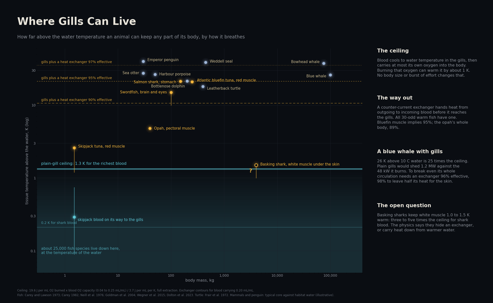
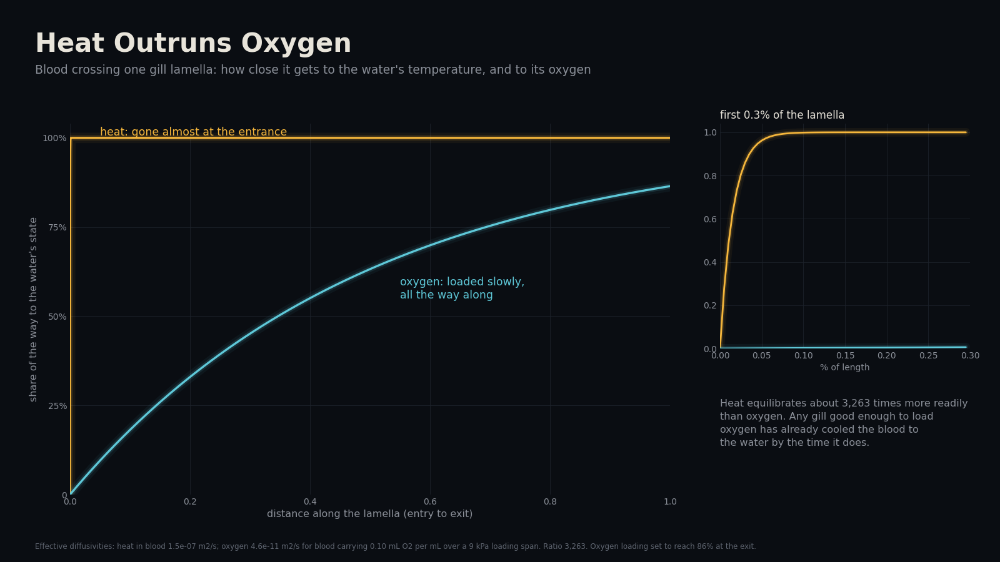
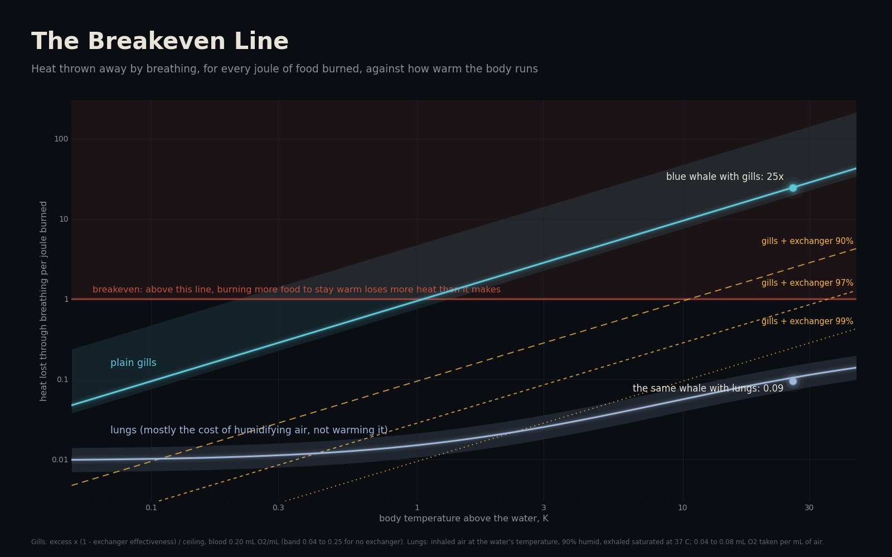
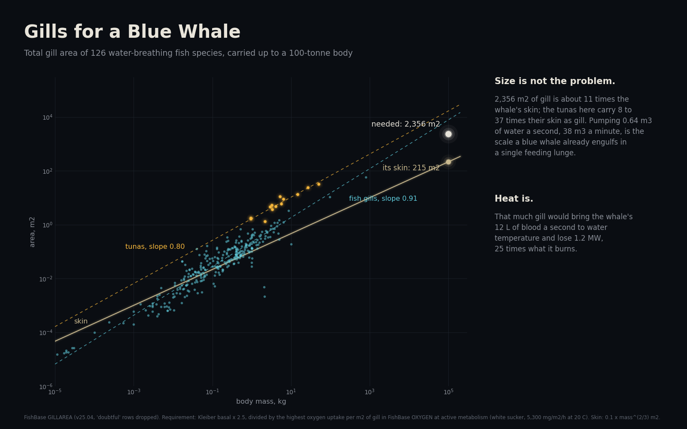

# The Gill Penalty

**Why didn't whales get gills?**

The usual answers are that water holds little oxygen, and that evolution cannot run backwards. Both are true, but neither explains why no warm-blooded animal of any size breathes water. This project puts a number on the real obstacle: heat. Blood that passes a gill leaves at the temperature of the sea, and it can carry only enough oxygen to warm itself by about one kelvin before it comes back. That ceiling holds for a minnow and for a blue whale alike, and the only way past it is a counter-current heat exchanger. Every warm fish has one.



## What it finds

- **Plain gills cap any tissue at about 1 K above the water.** Each mL of oxygen burned releases 19.6 J; a mL of blood holds at most its oxygen capacity and warms 1 K per 3.7 J. So blood that left the gill at sea temperature can be warmed by at most `19.6 × capacity / 3.7` kelvin: 1.06 K for blood as rich as a mammal's or a tuna's (0.20 mL O₂ per mL), 0.53 K for a typical teleost (0.10), 0.32 K for shark blood (0.06). Body size and effort cancel out of the ratio: a bigger or busier animal burns more oxygen and must pump proportionally more blood past its gills.
- **The gill cannot avoid it.** Across the same wall, blood reaches the water's temperature 3,300 to 6,500 times more readily than it reaches the water's oxygen level. By the time a lamella has loaded oxygen, the heat went in the first fraction of a percent of its length.
- **Every warm fish beats the ceiling with an exchanger, and the size of the beat says how good it is.** Bluefin tuna red muscle runs 21 K above the water, 22 times its ceiling, which implies a heat exchanger at least 95.5% effective. The salmon shark's stomach (21.2 K) implies 97.0%, the swordfish's brain heater (15 K) 96.5%, the opah's whole body (4.8 K) 89%.
- **The prediction that could fail did not.** Neill and colleagues (1976) measured the blood leaving skipjack tuna muscle on its way back to the gills, after the exchanger: 0.09 to 0.74 K above the water. The model says it can never exceed the plain ceiling for tuna blood, 0.79 to 1.17 K. It does not. And no fish in the table without a known exchanger holds a steady excess above its ceiling; the one fish over the line without one, the basking shark, is the open question below.
- **A blue whale with gills cannot break even.** At 36 °C in 10 °C water it would run 24.5 times its ceiling. Plain gills would shed 1.2 MW against the 48 kW it burns, and eating more only makes it worse: more food needs more oxygen, which needs more blood through the gills. Its whole circulation would need an exchanger 95.9% effective just to break even, and 98.0% to leave half its heat for the skin. That is better than any measured fish manages for its whole body (the opah, 89%), and tunas keep even their hearts at water temperature.
- **Size is not the problem.** The gill area such a whale needs, 2,356 m², is 11 times its skin; the tunas in FishBase carry 8 to 37 times their skin as gill. Pumping 0.64 m³ of water a second is the scale a blue whale already engulfs in a feeding lunge.
- **Lungs cost almost nothing in heat.** Warming and wetting the air for the same whale throws away about 10% of what it burns (taking 6% of each breath as oxygen), mostly as water vapour, and less once the nose recovers some of it.



## The ceiling and the way past it

In steady state, heat made in a tissue leaves either in the blood or through the skin. The blood arrives from the gills at water temperature and, at full oxygen extraction, can absorb at most `Q_OX × capacity` joules per mL from the oxygen it brought. So no perfused tissue can sit more than

```
ceiling = Q_OX × capacity × extraction / C_BLOOD
```

above the water, whatever the body's size, metabolic rate or skin. A counter-current exchanger of effectiveness `e` between the warm tissue and the gill hands heat from outgoing to incoming blood, raising the ceiling to `ceiling / (1 − e)`. The heat lost through the gills per joule burned is `excess × (1 − e) / ceiling`. When that exceeds 1, the animal cannot stay that warm at any feeding rate.

[src/physics.py](src/physics.py) holds these few lines, plus an explicit loop (tissue, exchanger, gill, skin) solved as a linear system to check the algebra, the effective diffusivities behind the heat-versus-oxygen ratio, a lung heat budget and the Weiss oxygen solubility of seawater.



## Animals against the ceiling

| Animal | Tissue | Above the water | Its plain ceiling | Times the ceiling | Exchanger implied |
|---|---|---|---|---|---|
| Atlantic bluefin tuna | red muscle | 21.0 K | 0.95 K | 22 | 95.5% |
| Salmon shark | stomach | 21.2 K | 0.64 K | 33 | 97.0% |
| Swordfish | brain and eyes | 10 to 15 K | 0.53 K | 28 | 96.5% |
| Opah | pectoral muscle (whole body) | 4.8 K | 0.53 K | 9 | 89.0% |
| Skipjack tuna, 1.5 kg in tanks | red muscle | 1.2 to 2.6 K | 0.95 K | 2.7 | 63% |
| Skipjack tuna, 1.5 kg in tanks | blood returning to the gills | 0.09 to 0.74 K | 0.95 K | 0.3 | none |
| Basking shark | white muscle under the skin | 1.0 to 1.5 K | 0.32 K | 4.7 | 79% |

Ceilings use each group's assumed blood oxygen capacity (below); "times the ceiling" and "exchanger implied" use the upper excess.

**The open question: basking sharks.** Dolton and colleagues (2023) found basking shark white muscle 1.0 to 1.5 K above the water, a centrally placed red muscle like the lamnid sharks, and a thick-walled heart. That is three to five times the plain ceiling for shark blood, and even the most generous shark blood (0.08 mL/mL, ceiling 0.42 K) leaves the lower reading 2.4 times over. No heat exchanger has been reported. The model says one of two things is true: they have an exchanger at least 58% effective, or the warmth is stored heat carried down from warmer water and not a steady state. Either is testable with a dissection or a long tag record.

## A blue whale with gills



[results/gilled_whale.json](results/gilled_whale.json) has the budget. Metabolism is 2.5 times Kleiber's basal rate (47.7 kW for 100 t); marine mammals run 2 to 5 times, which moves the gill area and water flow but not the heat penalty, because the penalty depends only on the excess and the ceiling. Gill area divides the oxygen demand by the highest uptake per square metre of gill in FishBase (white sucker at active metabolism, 5,300 mg O₂ per m² per hour at 20 °C). Gill areas themselves come from 308 FishBase records across 126 species; total gill area scales with body mass to the power 0.91 pooled, 0.79 within species (median of 32 species with a usable size range).

## How sure

21 tests in [tests/test_physics.py](tests/test_physics.py), each of which could fail:

- **Constants.** Oxygen solubility reproduces the USGS freshwater tables (14.62 mg/L at 0 °C, 9.09 at 20 °C) and saturated air holds 44 mg of water per litre at 37 °C.
- **Mechanism.** For any oxygen capacity from 0.04 to 0.25 and any gill that loads oxygen only partly, the blood's heat exchange is over 99.99% complete.
- **Algebra.** A thousand random fish (blood flow over six orders of magnitude, any extraction, exchanger and skin loss) solved as an explicit loop never beat `ceiling / (1 − e)`, and their returning blood never beats the plain ceiling. Changing blood flow by a factor of a million leaves the ceiling unchanged.
- **Animals.** Skipjack returning blood stays under the lowest tuna ceiling; every fish with a steady excess above the most generous ceiling for its blood has an exchanger; every air-breather loses under 30% of its heat breathing; lungs beat gills by more than a hundredfold at 30 K.

What is not settled:

- **Blood oxygen capacities are assumed, not measured for these animals.** They are typical ranges by group (tunas 0.15 to 0.22 mL/mL, teleosts 0.07 to 0.13, lamnid sharks 0.08 to 0.16, other sharks 0.04 to 0.08), set by the AI model that built this project from general physiology, and the tests use the generous end. The headline needs only that no vertebrate blood carries much more than 0.25 mL/mL.
- **Steady state only.** A large fish carries heat stored in warm water down into cold water for hours (blue sharks, probably basking sharks). The ceiling says nothing about that.
- **Anaerobic heat is ignored.** Glycolysis to lactate releases heat without oxygen, but no animal can sustain it.
- **The mammal and penguin points are illustrative**: a typical core temperature against typical habitat water, not paired measurements. The leatherback (25.5 °C in 7.5 °C water) is a measurement.
- **The lung figures are upper bounds.** Whales and seals cool their exhaled air in the nose, which this ignores.

## Interactive

[docs/index.html](docs/index.html) lets you build an animal: pick gills or lungs, set its size, the water, its body temperature, its blood and its heat exchanger, and watch the heat budget. The bar for heat lost through breathing is drawn to the same scale as the heat burned, so for a gilled whale it runs off the page. It works on GitHub Pages from the `docs` folder.

## Data and sources

- FishBase (Froese and Pauly, version 25.04), tables GILLAREA, OXYGEN, SPECIES and FAMILIES, from the rOpenSci parquet mirror on Hugging Face. See [DATA.md](DATA.md).
- Animal temperatures, each in [data/labels/excess.csv](data/labels/excess.csv) with its source: Carey and Lawson 1973 (bluefin); Carey 1982 (swordfish); Neill, Chang and Dizon 1976 (skipjack); Goldman et al. 2004 (salmon shark); Wegner et al. 2015 (opah); Dolton et al. 2023 (basking shark); Frair, Ackman and Mrosovsky 1972 (leatherback); Block 2011 for the count of endothermic fishes and their shared reliance on retia.
- Weiss 1970 for oxygen in seawater; Kleiber's 70 kcal per day per kg^0.75; Meeh's surface rule with k = 0.1.

## Run it

```
pip install -r requirements.txt
cd src
python run_all.py      # download, FishBase, whale, animals, figures, page
cd ..
python -m pytest -q tests
```

Everything runs in under a minute on a laptop.
